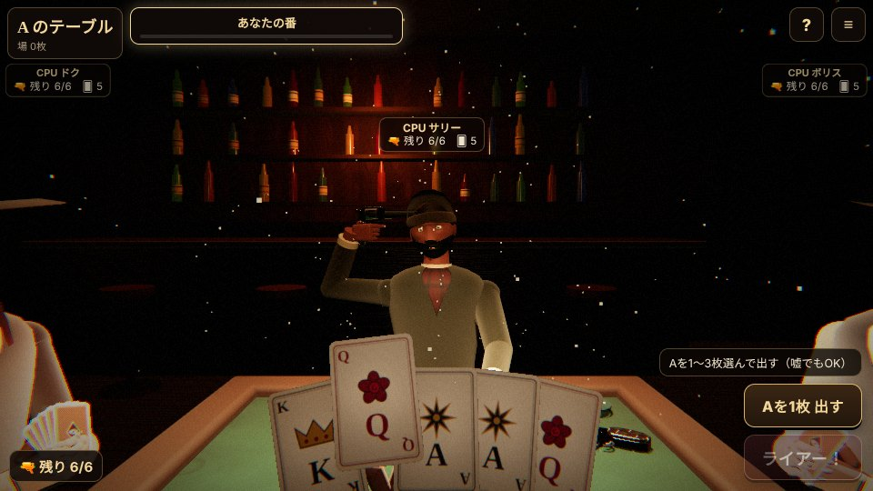

# Liar's Table — 嘘つきたちの卓

ブラウザだけで遊べる、3D一人称の心理戦デスゲームです。  
最大4人でテーブルを囲み、嘘と見破りで最後の1人まで生き残りを競います（カードは手札を出し切って告発を逃れる「あがり」でも勝利）。



- **カード（リボルバー）**：嘘がバレたら、または冤罪で告発したら、自分の頭にリボルバーを撃つ
- **ダイス（毒薬）**：ベットの読み合いに負けたら毒を飲む。2本目で死亡。いまのベット（何の目が何個以上か）と自分の手元の個数を常に表示
- **ロビーIDとパスワード**で友達と集まってオンライン対戦。空席はCPUで埋められます。席順はゲームごとにランダム
- **一人称視点**：あなたが見回すと、その頭の動きが他の人にもそのまま見えます
- **手札は絶対に見えない**：他人の手札・ダイスは本人だけが読める暗号で送られます（死亡後の観戦中も見えません）
- インストール不要・画像や音声ファイルなし（テクスチャも効果音もすべてコードで生成）

> 本作は『Liar's Bar』（Curve Animation）のルールに着想を得た非公式のファン作品です。公式とは一切関係ありません。キャラクター・カード・小道具のデザインはすべてオリジナルです。

---

## 遊び方

ゲーム内の「ルール」ボタン（タイトル画面・ロビー・プレイ中の「?」）から、図解つきのルール説明が見られます。初めてロビーに入ったときは、かんたん説明も表示されます。

### カード（ライアーズ・デッキ）

1. 山札は20枚（A×6、K×6、Q×6、ジョーカー×2）。全員に5枚ずつ配ります。
2. ラウンドごとに **テーブルカード**（A・K・Q のどれか）が決まります。
3. 手番では手札を1〜3枚、裏向きで出します。出したカードはすべて「テーブルカード」と宣言したことになります（嘘でもOK）。ジョーカーはどのカードの代わりにもなります。
4. 次の人は「カードを出す」か「ライアー！」で直前の人を告発します。
5. 嘘が混ざっていれば **出した人**、全部本物なら **告発した人** がリボルバーを撃ちます。
6. リボルバーは6発中1発が実弾。撃つ前にシリンダーを振り出して回し、こめかみに当てて引き金を引きます。生き残るたびに次の死亡率が上がります（1/6 → 1/5 → … → 確実）。
7. **あがり**：手札を全部出し切ったあと、次の人が「ライアー！」と言わずにカードを出したら、その時点で勝利（最後のカードが嘘でも、見逃されれば勝ち）。告発された場合は通常どおり判定します。
8. 自分以外の全員が手札切れになると、最後のカードは自動的に告発されます。

### ダイス（ライアーズ・ダイス）

1. 全員がカップの中で5個のダイスを振ります。自分のダイスだけ見えます。
2. 「○の目がテーブル全体でX個以上ある」とベットします。
3. 次の人は **個数を増やす** か **同じ個数で大きい目** にして上乗せするか、「ライアー！」で告発します。個数を増やすなら目はどれでもOK（例：「6の目が2個」の次は、3個以上ならどの目でも）。
4. **1はワイルド**（どの目としても数える。1そのものにベットした場合は1だけ数える）。
5. 公開して、宣言以上あれば告発した人、足りなければ宣言した人が毒を飲みます。毒は2本目で死亡。

### 操作

| 操作 | スマホ | PC |
|---|---|---|
| 見回す | 画面をドラッグ | ドラッグ／矢印キー |
| カードを選ぶ | 手札をタップ（最大3枚） | クリック |
| 出す・ベット・ライアー | 画面のボタン | 画面のボタン |
| サウンド・画質・ヒント | ≡ メニュー | ≡ メニュー |

---

## GitHub Pages で公開する

1. GitHub で新しいリポジトリを作ります（例：`liars-table`）。
2. このフォルダの中身をすべてアップロードします（`index.html` がリポジトリの一番上に来るように）。
3. リポジトリの **Settings → Pages** を開き、**Source** を「Deploy from a branch」、**Branch** を `main` / `/ (root)` にして **Save**。
4. 1〜2分後、`https://<ユーザー名>.github.io/<リポジトリ名>/` で遊べます。このURLを友達に送ってください。

`.nojekyll` は GitHub Pages の自動変換を止めるためのファイルです。消さないでください。

### オンライン対戦のしくみ

- **GitHub Pages など普通のWebサイト**：[PeerJS](https://peerjs.com/)（WebRTC）でブラウザ同士を直接つなぎます。ロビーを作った人（ホスト）の端末がゲームの進行役になります。接続の仲介には PeerJS の無料公開サーバーを使います。
- **claude.ai のアーティファクト**：claude.ai の「room」機能で通信します（`npm run build:single` で作る1ファイル版）。

どちらも同じコードで、実行環境に合わせて自動で切り替わります。

#### つながらないとき

携帯回線や社内ネットワークなど、WebRTC が直接通らない環境では TURN サーバーが必要になることがあります。`js/config.js` で設定できます。

```js
window.LIARS_TABLE_CONFIG = {
  iceServers: [
    { urls: 'stun:stun.l.google.com:19302' },
    { urls: 'turn:YOUR_TURN_HOST:3478', username: 'USER', credential: 'PASS' },
  ],
  // 自前の PeerJS サーバー（https://github.com/peers/peerjs-server）を使う場合
  // peerServer: { host: 'your-peer-server.example.com', port: 443, path: '/', secure: true },
};
```

---

## 手元で動かす

ES モジュールを使っているため、`index.html` をダブルクリックで開くだけでは動きません。簡易サーバーを立ててください。

```bash
npx serve .          # または: python3 -m http.server 8000
```

ブラウザで表示されたURL（例：`http://localhost:3000`）を開きます。

### テスト

```bash
npm test             # ルールエンジンの自動テスト（数百ゲームを自動対戦して検証）
```

### claude.ai 用の1ファイル版を作る

```bash
npm run build:single # → dist/liars-table.html
```

---

## ファイル構成

```
index.html          画面の骨組み
css/style.css       見た目（HUD・メニュー・ルール画面）
js/
  main.js           エントリーポイント
  app.js            画面遷移・ロビー・HUD・通信の制御
  engine.js         ルールエンジン（ホストが進行。DOM非依存でテスト可能）＋CPUの思考
  world.js          3D描画・一人称カメラ・アニメーション・死亡演出
  avatar.js         キャラクター（顔の造形、目・まぶた、髪・ひげ、5本指の手、腕のIK）
  face.js           顔の形状と顔テクスチャ用の座標
  models.js         酒場・テーブル・リボルバー・毒瓶・ダイスなどの小道具
  textures.js       木目・布・肌・カードなどのテクスチャ生成
  post.js           ブルーム・フィルムグレイン・周辺減光
  audio.js          効果音（Web Audio で合成）
  rules.js          ルール説明（図解）とかんたん説明
  net-room.js       通信: claude.ai の room
  net-peer.js       通信: PeerJS（WebRTC P2P）
  crypto.js         手札の暗号化（ECDH + AES-GCM）
  config.js         任意設定（TURN サーバーなど）
test/engine.test.mjs  ルールエンジンのテスト
tools/build-single.mjs 1ファイル版のビルド
```

外部ライブラリ（[three.js](https://threejs.org/) r160、PeerJS 1.5.5）は CDN（jsDelivr）から読み込みます。

## 注意事項

- 配札・ダイスはホストの端末で行うため、ホストのブラウザ内部には全員分のデータがあります（画面には表示されません）。サーバーを使わない以上、避けられない仕組みです。
- ホストが退出するとゲームは終了します。プレイ中に退出したプレイヤーは死亡扱いになります。
- 画質はメニューで「自動／高／中／低」を切り替えられます。「自動」は動作が重いと段階的に下げます。

## ライセンス

[MIT](LICENSE)
